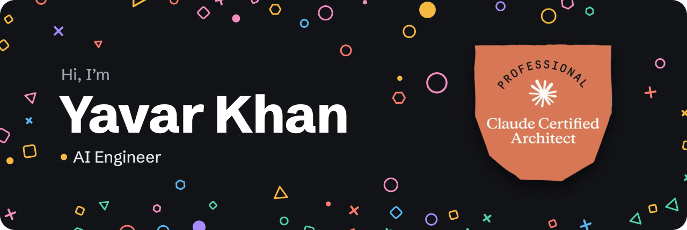

  

  &nbsp;
  &nbsp;
  &nbsp;
  

<i>AI engineer building end-to-end, high-stakes decision systems, with a background in mission-critical enterprise software.</i>

<table>
  <tr>
    <td width="33%" valign="top">
      <b>🌱 Now</b> 
      <b>AI Engineer at <a href="https://aerveil.ai/">Aerveil</a></b> 
      Frost and spray decisions for vineyards, block by block, delivered on WhatsApp with the reasoning behind every call.
    </td>
    <td width="33%" valign="top">
      <b>🏅 Certified</b> 
      <a href="https://www.credly.com/badges/99356023-0947-49a6-8c38-007c8ad9bcde/public_url"><b>Claude Certified Architect – Professional</b></a> 
      Anthropic · Oct 2026 · also <a href="https://www.credly.com/badges/4e40f189-2df1-492b-8dfe-dfb93a568198/public_url">Foundations</a> (Jul 2026)
    </td>
    <td width="33%" valign="top">
      <b>🎓 Education</b> 
      <b>M.S. Computer Science (AI/ML)</b> 
      University at Buffalo, SUNY · GPA 3.87 · Aug 2024 – Dec 2025
    </td>
  </tr>
</table>

## 🚀 Featured projects

<table>
  <tr>
    <td width="33%" valign="top">
      <h3>WeatherWise.AI</h3>
      Claude-powered LangGraph multi-agent weather analyst over live Xweather MCP data, with multimodal RAG and interactive dashboards.  
      
       
      LangGraph · Claude · MCP · Pinecone · GCP · with <a href="https://ishitasrivastava.me/">Ishita Srivastava</a>
    </td>
    <td width="33%" valign="top">
      <h3>Deep Research Pro</h3>
      Multi-agent research system on the OpenAI Agents SDK, delivering ~40-source cited reports in ~1 min.  
      
       
      OpenAI Agents SDK · Pydantic · SQLite · Gradio
    </td>
    <td width="33%" valign="top">
      <h3>Context-Aware RAG Assistant</h3>
      Identity-grounded personal AI assistant with FAISS semantic retrieval and persona-adaptive reasoning.  
       
      LangChain · FAISS · FastAPI · Gradio
    </td>
  </tr>
</table>

<b>🔍 Project highlights</b>

 

**WeatherWise.AI**

- Built a Claude-powered LangGraph multi-agent weather analyst running parallel tasks across live Vaisala Xweather MCP data, sandboxed code execution and LLM-generated interactive ECharts dashboards.
- Implemented multimodal RAG (text, tables, figures) in Pinecone over NOAA, NASA and National Climate Assessment reports; added prompt caching and LangSmith tracing, deployed on GCP Cloud Run via Terraform.

**Deep Research Pro**

- Built a multi-agent research system on the OpenAI Agents SDK: human-reviewed query planning, parallel search agents, adaptive follow-up waves and Pydantic-validated reports.
- Delivered ~40-source cited reports in ~1 min via async fan-out and two-tier (in-memory + SQLite) caching; grounded citations in search-tool URL annotations to prevent hallucinated links.

**Context-Aware AI RAG Assistant (Identity-Aware Career Agent)**

- Designed an identity-grounded personal AI assistant using **FAISS-powered semantic retrieval** and **persona-adaptive reasoning**.
- Built with **Gradio**, **LangChain-style architecture**, and **OpenAI function calling** for tool-driven workflows.
- Includes **notification system**, **memory logging**, and **hallucination-safe output enforcement**.

<b>💼 Experience</b>

 

**AI Engineer · [Aerveil](https://aerveil.ai/)** · San Jose, CA · *Mar 2026 – Present* 
*First engineer, pre-seed agtech startup*

- Built an end-to-end vineyard decision engine for frost protection and spray timing, issuing per-block calls on high-stakes crop decisions.
- Developed a WhatsApp AI agent on the Anthropic Python SDK and Twilio, answering from tenant-isolated tool calls over each block's forecasts, records and past decisions.
- Re-architected decisions from LLM-led to deterministic, with grounded Claude narration and LLM-as-judge eval gates in CI, eliminating ~15% unstable refusals, cutting spray and frost LLM spend by 96%.
- Engineered NOAA weather ingestion pipelines, Claude-based pesticide label extraction with human review, and auditable partitioned Postgres/PostGIS decision history on GCP.
- Partnered with a 26-acre, 6-block vineyard from demo to onboarding, evolving spray windows from weather-only to product-specific based on their feedback.

**Software Engineering Analyst · Accenture** · Pune, India · *Dec 2020 – Aug 2023* 
*Software Engineering Analyst (2022 – 2023) · Software Engineering Associate (2020 – 2022)*

- Operated 120+ OAuth 2.0 APIs on Apigee and AWS for a Fortune 500 pharma client, serving millions of requests/month at 99.9% uptime.
- Cut API error rate from 25% to under 1% in 3 months, tracing failures to endpoints and client apps and hotfixing timeouts and bad redirects.
- Automated a ~1-week manual audit with a Python script that pulled 6 months of per-API-key traffic from Apigee analytics and flagged unused developer apps, leading to 15–20 dead endpoints being retired.
- Deployed 50+ API releases and hotfixes across all environments with Jenkins and Ansible with US, Singapore and Prague teams; trained 5 teammates on the end-to-end release process.

<b>🧠 Earlier machine learning work</b>

 

| Project | What it is |
| --- | --- |
| [Transformer-Based Sentiment Analysis](https://github.com/yavar29/ML_Projects/tree/main/Deep%20Learning%20Models/Transformer) | Custom Transformer (positional encoding, MHA, dropout, early stopping); **91.8% accuracy** and **0.92 F1-score** on **560K** Yelp reviews. |
| [VGG-16 vs ResNet-18](https://github.com/yavar29/ML_Projects/tree/main/Deep%20Learning%20Models/VGG%20and%20Resnet) | CNN pipelines with regularization, augmentation and LR scheduling; **96.5% (VGG-16)** and **94.5% (ResNet-18)** accuracy. |
| [ThermoWatch-AE](https://github.com/yavar29/ML_Projects/tree/main/Deep%20Learning%20Models/Autoencoder_AnomalyDetection) | Deep autoencoder for temperature-based anomaly detection with reconstruction-loss thresholds. |
| [Reinforcement Learning Grid Navigation](https://github.com/yavar29/ML_Projects/tree/main/Reinforcement%20Learning%20Models%20) | SARSA and n-step Double Q-learning agents for grid-world navigation, tuned with Optuna. |
| [EMNIST Character Recognition](https://github.com/yavar29/ML_Projects/tree/main/Deep%20Learning%20Models/Convolutional%20Neural%20Network/EMNIST_text_recognition) | CNN for 36-class handwritten character recognition. |
| [Speech Emotion Recognition](https://github.com/yavar29/ML_Projects/tree/main/Deep%20Learning%20Models/Convolutional%20Neural%20Network/SpeechEmotionRecognition) | 1D CNN classifying five emotions from speech using MFCC features. |

<b>🏆 Certifications</b>

 

- [Claude Certified Architect – Professional](https://www.credly.com/badges/99356023-0947-49a6-8c38-007c8ad9bcde/public_url), Anthropic (Oct 2026)
- [Claude Certified Architect – Foundations](https://www.credly.com/badges/4e40f189-2df1-492b-8dfe-dfb93a568198/public_url), Anthropic (Jul 2026)
- [AWS Certified Cloud Practitioner](https://cp.certmetrics.com/amazon/en/public/verify/credential/S2JVD4E1X2VQQ7KF) (2023)
- [Machine Learning Specialization – Stanford/DeepLearning.AI](https://coursera.org/share/3d553a1ae631d19e95226287190bc71c) (2023)

<b>🎓 Education</b>

 

- **University at Buffalo, SUNY** · M.S. Computer Science (AI/ML) · *Aug 2024 – Dec 2025* · **GPA:** 3.87
- **Amity University, India** · B.Tech. Information Technology · *Jul 2016 – May 2020*

## ⚡ Tech stack

**AI & LLMs** 

**Backend & Data** 

**Cloud & DevOps** 

<b>💡 Let’s build reliable, explainable AI together.</b>

